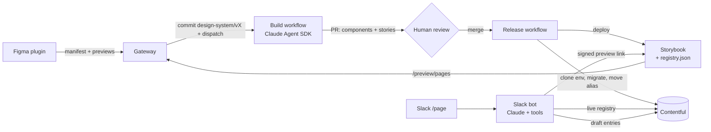

# StoryPage

An AI pipeline from **Figma → Storybook → Contentful → Slack**:

1. A designer builds the design system in Figma and presses **Publish** in the StoryPage Figma plugin.
2. A Claude agent builds or updates the components in **Storybook** in the background and opens a PR.
3. When the PR merges, Storybook is deployed and **Contentful** content types are migrated to match, in a new versioned environment.
4. Anyone can ask the **Slack bot** for a page; it composes the page from those components and saves it as a Contentful draft, with a Storybook-rendered preview.



Every stage reads the same versioned **manifest** (`packages/design-system/manifests/<version>.json`), so tokens, components, content types and pages can't drift apart. See [docs/architecture.md](docs/architecture.md) for the details: versioning rules, the content migration strategy, Figma annotations and the security model.

## Repository layout

| Path | What it is |
|------|------------|
| `packages/schema` | Manifest schema, semver diffing, page validation, token codegen, Figma annotation parsing, Contentful mapping. Shared by everything. |
| `packages/design-system` | The Storybook design system: React components, stories, generated tokens/registry, `PageRenderer`, contract tests. |
| `packages/contentful` | Content-model sync (versioned environments, no data loss), page writer/publisher, signed preview tokens. |
| `apps/figma-plugin` | Figma plugin that extracts and publishes the design system. |
| `apps/gateway` | Small HTTP service: receives publishes, commits manifests, triggers the build, serves signed draft previews. |
| `apps/storybook-agent` | Claude Agent SDK runner that implements a manifest diff in Storybook and verifies it. |
| `apps/slack-bot` | Slack app that composes pages with Claude and writes them to Contentful. |
| `.github/workflows` | CI, the agent build (`design-system-build.yml`) and the release (`design-system-release.yml`). |

## Quick start (local)

Requires Node 22+ and pnpm 10.

```bash
pnpm install
pnpm test                                        # 76 tests across all packages
pnpm --filter @storypage/design-system storybook # http://localhost:6006
```

The repo ships with a seed design system (`manifests/1.0.0.json`: tokens, `Button`, `FeatureCard`, `Hero`, `FeatureGrid`, `RichTextSection`) so every stage works before the first Figma publish.

## Setting it up

### 1. Gateway

Deploy `apps/gateway` anywhere that runs Node (`pnpm --filter @storypage/gateway start`). See [`apps/gateway/.env.example`](apps/gateway/.env.example). It needs a GitHub token that can create branches and send `repository_dispatch` events (a fine-grained token with *Contents: read & write*).

### 2. Figma plugin

```bash
pnpm --filter @storypage/figma-plugin build
```

Set your gateway's URL in `apps/figma-plugin/manifest.json` → `networkAccess.allowedDomains`, then in Figma use **Plugins → Development → Import plugin from manifest…**. Publish it privately to your organization when ready. The first time it runs, enter the gateway URL and the publish token.

### 3. GitHub

| Kind | Name | Used by |
|------|------|---------|
| Secret | `ANTHROPIC_API_KEY` | Storybook agent |
| Secret | `STORYPAGE_BOT_TOKEN` (optional) | Pushing and opening the release PR. A PAT/App token lets the PR trigger CI; PRs opened with `GITHUB_TOKEN` don't. |
| Secret | `CONTENTFUL_MANAGEMENT_TOKEN` | Contentful sync |
| Variable | `CONTENTFUL_SPACE_ID`, `CONTENTFUL_ENVIRONMENT` (default `master`), `CONTENTFUL_LOCALE` (default `en-US`) | Contentful sync |
| Variable | `CONTENTFUL_SYNC_STRATEGY` (`alias` default, or `in-place`), `CONTENTFUL_KEEP_ENVIRONMENTS` (optional) | Contentful sync |
| Variable | `STORYPAGE_GATEWAY_URL` | Storybook preview story |
| Variable | `STORYPAGE_AGENT_MAX_BUDGET_USD` (default 25) | Agent spend cap per run |

Enable GitHub Pages with source **GitHub Actions** (or swap the deploy job for your host).

### 4. Contentful

Create a management token with access to the space. The default `alias` strategy needs [environment aliases](https://www.contentful.com/developers/docs/concepts/environment-aliases/) with `master` as an alias. Without them, set `CONTENTFUL_SYNC_STRATEGY=in-place`. To bootstrap from the seed design system, run the **Design system release** workflow once manually.

### 5. Slack bot

Create a Slack app from [`apps/slack-bot/manifest.yml`](apps/slack-bot/manifest.yml), install it, and deploy `apps/slack-bot` with the variables in [`apps/slack-bot/.env.example`](apps/slack-bot/.env.example). `PREVIEW_SIGNING_SECRET` must match the gateway's. For local development, set `SLACK_APP_TOKEN` to use Socket Mode (no public URL needed).

## Using it

**Designers:** annotate components in Figma (see [Figma annotations](docs/architecture.md#figma-annotations)), open the plugin, **Scan file**, check the diff and the suggested version, write what changed, and **Publish**. A PR titled *Design system x.y.z* follows a few minutes later.

**Engineers:** review the PR like any other. It contains the agent's summary, the diff, and the verification result (typecheck, contract tests, Storybook build). If verification failed, the PR is a draft. Merging releases it.

**Everyone else:** in Slack, run `/page a landing page for our October webinar on AI search` or mention `@StoryPage`. Reply in the thread to change the page. **Preview** opens it rendered by Storybook, **Open in Contentful** lets editors fine-tune it, and **Publish** makes it live (limited to `SLACK_PUBLISHER_IDS` if set).
