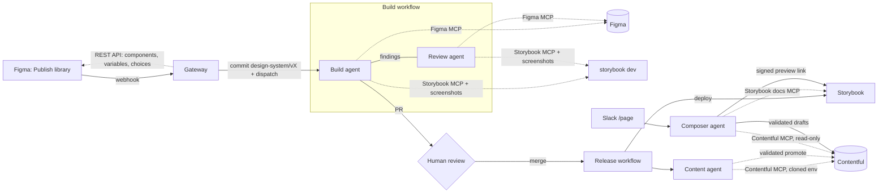

# StoryPage

An agentic pipeline from **Figma → Storybook → Contentful → Slack**, built on the Claude Agent SDK with the Figma, Storybook and Contentful MCP servers:

1. A designer builds the design system in Figma, the way they already do (components, variants, variables, styles), and publishes the library with Figma's own **Publish library**. A webhook starts StoryPage. The publish description becomes the release notes, and the version number is worked out from what changed.
2. **Build agent:** implements the components in **Storybook**, reading the design through the **Figma MCP** and the existing system through the **Storybook MCP**, and checks its work with story screenshots and the contract tests.
3. **Review agent:** a separate agent compares every changed story with Figma. Blocking findings go back to the build agent, and the result is opened as a PR for a human.
4. **Content agent:** once the PR merges and Storybook deploys, it migrates the **Contentful** content model *and the existing content* through the **Contentful MCP**, in a cloned environment. It goes live only after every page validates.
5. **Composer agent:** anyone can ask the **Slack bot** for a page. It reads component docs through the Storybook MCP and existing content through the Contentful MCP, then saves a validated draft with a Storybook-rendered preview.



The steps that must be exact are deterministic code the agents call as tools: token generation, the content-model planner, validation, promotion. Every stage reads the same versioned **manifest** (`packages/design-system/manifests/<version>.json`), so tokens, components, content types and pages can't drift apart. See [docs/architecture.md](docs/architecture.md) for the stages, their tools and guardrails, versioning, and the security model.

## Repository layout

| Path | What it is |
|------|------------|
| `packages/schema` | Manifest schema, semver diffing, page validation, token codegen, Figma annotation parsing, Contentful mapping. Shared by everything. |
| `packages/agents` | The agent runtime: stage runner on the Claude Agent SDK, Figma/Contentful/Storybook MCP configs, per-stage tool policies, and the in-process pipeline tools (verify, screenshot, content-model steps, page drafts). |
| `packages/design-system` | The Storybook design system: React components, stories, generated tokens/registry, `PageRenderer`, contract tests, Storybook MCP addon. |
| `packages/figma` | Figma REST client and the server-side library reader (components, variants, properties, styles, variables, the plugin's saved choices). |
| `packages/contentful` | Content-model planning and release steps (clone, apply, find stranded content, validate, promote), page writer/publisher, signed preview tokens. |
| `apps/pipeline` | The pipeline CLI: `build` (build agent → review agent → verify → PR body) and `release` (content agent). |
| `apps/figma-plugin` | Figma plugin where designers choose what each component becomes; saves the choices (and variable values) in the file. |
| `apps/gateway` | Small HTTP service: receives Figma's library-publish webhook (and the plugin's optional publish), commits manifests, starts the build on GitHub Actions or its own hosted runner, serves signed draft previews and the hosted Storybook. |
| `apps/slack-bot` | Slack app running the composer agent. |
| `e2e` | The end-to-end run (`pnpm e2e`) with local stand-ins for Figma, GitHub and Contentful, and `pnpm e2e:doctor` for checking a real setup. |
| `.github/workflows` | CI, the build stage (`design-system-build.yml`) and the release stage (`design-system-release.yml`), for the open-source setup. |
| `Dockerfile` | The hosted setup: gateway plus a runner that runs the same stages itself. |

## Quick start (local)

Requires Node 22+ and pnpm 10.

```bash
pnpm install
pnpm test                                        # unit tests plus an end-to-end Agent SDK session against a scripted model
pnpm --filter @storypage/design-system storybook # http://localhost:6006
```

To run the whole flow (Figma publish → pull request → merge → Storybook and Contentful release → Slack draft → preview) on your machine without any accounts:

```bash
pnpm e2e            # report, PR body, logs and a preview screenshot in .storypage-e2e/
pnpm e2e --serve    # then keep it running to click around
```

See [docs/testing.md](docs/testing.md) for what it covers, `--with-agents`, and a checklist for a live run on real services.

The repo ships with a seed design system (`manifests/1.0.0.json`: tokens, `Button`, `FeatureCard`, `Hero`, `FeatureGrid`, `RichTextSection`) so every stage works before the first Figma publish.

## Setting it up

### 0. Choose where the agents run

The same pipeline code (`apps/pipeline`) runs in either place:

| | **GitHub Actions** (open source) | **Hosted worker** |
|---|---|---|
| What runs the agents | The workflows in `.github/workflows` | The gateway itself, from the `Dockerfile` (`STORYPAGE_RUNNER=local`) |
| You host | Only the gateway (a small Node service) | One container with a volume |
| Storybook | GitHub Pages (or your host) | Served by the gateway at `/storybook/` |
| After a PR merges | `design-system-release.yml` runs | A GitHub webhook starts the release job |
| Figma's official MCP | Needs a self-hosted runner, so the sign-in persists | Works out of the box: the sign-in lives on the volume |

Start with GitHub Actions; moving to the hosted worker later is a configuration change, not a rewrite.

### 1. Gateway

Deploy `apps/gateway` anywhere that runs Node (`pnpm --filter @storypage/gateway start`), or the `Dockerfile` for the hosted worker. See [`apps/gateway/.env.example`](apps/gateway/.env.example). It needs a GitHub token that can create branches, open pull requests and send `repository_dispatch` events (a fine-grained token with *Contents* and *Pull requests: read & write*).

For the hosted worker, also set `STORYPAGE_RUNNER=local` and `STORYPAGE_PUBLIC_URL`. Then add a GitHub webhook (`<public url>/webhooks/github`, *Pull requests* events, secret `GITHUB_WEBHOOK_SECRET`) so merged design-system PRs are released.

### 2. Figma: publish the library as usual

Releases start from Figma's **Publish library**. Register a webhook for the design-system file once, with a Figma token that can edit the file and has the `webhooks:write` scope:

```bash
FIGMA_API_KEY=… FIGMA_FILE_KEYS=<file key> FIGMA_WEBHOOK_PASSCODE=<random> \
STORYPAGE_PUBLIC_URL=https://storypage.example.com \
pnpm --filter @storypage/gateway figma:webhook
```

The gateway reads the library over Figma's REST API with the same token (`FIGMA_API_KEY`, or `FIGMA_WEBHOOK_TOKEN`). Set `SLACK_NOTIFY_WEBHOOK_URL` to a Slack incoming webhook for the design team's channel, so designers hear what happened after they publish.

**Variables:** Figma's REST API serves variables only on Enterprise plans. On other plans the StoryPage plugin saves the variable values into the file whenever it's opened. If a publish changes variables after that, StoryPage asks in Slack for the plugin to be opened once more.

### 3. Figma plugin

```bash
pnpm --filter @storypage/figma-plugin build
```

In Figma use **Plugins → Development → Import plugin from manifest…**, then publish it privately to your organization so designers find it under **Plugins** like any other. Designers use it to choose what each component becomes (see *Using it*). It needs no connection settings for that. Its optional *Publish now* button, for files that aren't published as libraries, needs the gateway URL (also in `manifest.json` → `networkAccess.allowedDomains`) and the publish token.

### 4. Figma MCP for the agents (one time, not for designers)

The build and review agents read the design through **Figma's official MCP server** (`https://mcp.figma.com/mcp`). It signs in with OAuth only, and only from approved clients. Claude Code is one of them, and the Agent SDK runs Claude Code. So someone signs in **once** on the machine that runs the agents, with a Figma account that can view the design-system file (a shared "design bot" seat works well):

```bash
# hosted worker
docker exec -it <container> pnpm --filter @storypage/pipeline pipeline figma-connect --no-browser
# self-hosted GitHub runner
CLAUDE_CONFIG_DIR=/srv/storypage/claude pnpm --filter @storypage/pipeline pipeline figma-connect --no-browser
```

It prints a Figma sign-in link; open it, approve, and paste the redirect URL back. The grant is stored in `CLAUDE_CONFIG_DIR` and refreshed by later runs, so that directory must persist. On GitHub Actions, run the build workflow on a **self-hosted runner** with that directory: set the `STORYPAGE_AGENT_RUNNER` and `STORYPAGE_CLAUDE_CONFIG_DIR` variables. If Figma ever needs signing in again, the PR says so and the agents carry on from the manifest.

No persistent machine? Use GitHub-hosted runners with `FIGMA_MCP=framelink` and a `FIGMA_API_KEY` personal access token: the community Framelink server reads the same file over Figma's REST API.

### GitHub Actions settings (open-source setup)

| Kind | Name | Used by |
|------|------|---------|
| Secret | `ANTHROPIC_API_KEY` | Build, review and content agents |
| Variable | `STORYPAGE_AGENT_RUNNER`, `STORYPAGE_CLAUDE_CONFIG_DIR` | Self-hosted runner label and its persistent Claude config directory, for Figma's official MCP server |
| Variable | `FIGMA_MCP` (optional) | `official` (default), `framelink`, `url` with `FIGMA_MCP_URL`, or `off` (agents work from the manifest only) |
| Secret | `FIGMA_API_KEY` (only for `framelink`) | Figma personal access token with file read access |
| Secret | `STORYPAGE_BOT_TOKEN` (optional) | Pushing and opening the release PR. A PAT/App token lets the PR trigger CI; PRs opened with `GITHUB_TOKEN` don't. |
| Secret | `CONTENTFUL_MANAGEMENT_TOKEN` | Contentful sync |
| Variable | `CONTENTFUL_SPACE_ID`, `CONTENTFUL_ENVIRONMENT` (default `master`), `CONTENTFUL_LOCALE` (default `en-US`) | Contentful sync |
| Variable | `CONTENTFUL_SYNC_STRATEGY` (`alias` default, or `in-place`), `CONTENTFUL_KEEP_ENVIRONMENTS` (optional) | Contentful sync |
| Variable | `STORYPAGE_GATEWAY_URL` | Storybook preview story |
| Variable | `STORYPAGE_AGENT_MAX_BUDGET_USD` (default 25) | Spend cap per agent stage |
| Variable | `STORYPAGE_CONTENT_AGENT` (`false` to disable) | Release without the content agent: schema-only sync, no content migration |

Enable GitHub Pages with source **GitHub Actions** (or swap the deploy job for your host). The hosted worker reads the same names from its environment.

### 5. Contentful

Create a management token with access to the space. The default `alias` strategy needs [environment aliases](https://www.contentful.com/developers/docs/concepts/environment-aliases/) with `master` as an alias. Without them, set `CONTENTFUL_SYNC_STRATEGY=in-place`. To bootstrap from the seed design system, run the **Design system release** workflow once manually.

### 6. Slack bot

Create a Slack app from [`apps/slack-bot/manifest.yml`](apps/slack-bot/manifest.yml), install it, and deploy `apps/slack-bot` with the variables in [`apps/slack-bot/.env.example`](apps/slack-bot/.env.example). `PREVIEW_SIGNING_SECRET` must match the gateway's. For local development, set `SLACK_APP_TOKEN` to use Socket Mode (no public URL needed).

## Using it

**Designers** keep working the way they do now: components with variants and properties, variables, styles, and **Publish library** when it's ready. There is one new step, done once per component:

1. **Open the StoryPage plugin and choose what each component becomes.**
   - **Page section:** editors can add it to pages.
   - **Content block:** editors can put it inside other components, like a card in a grid.
   - **Storybook only:** built as code for other components to use.
   - **Not published.**

   **Use suggestions** picks likely page sections. Anything a chosen component is built from, or offers in a slot, is included automatically with the reason shown. For sections and blocks, **Content fields** shows what editors fill in: switch a text to *Paragraph*, *Formatted text* or *Link*, untick design-only options, or add an *Image* field. Choices save into the Figma file, so the whole team shares them. See [Choosing what to publish](docs/architecture.md#choosing-what-to-publish).
2. **Publish the library** as usual (Assets → Publish library), describing what changed.

StoryPage posts in Slack what it's building, which version that is, and anything it needs from you. A pull request titled *Design system x.y.z* follows a few minutes later.

**Engineers:** review the PR like any other. It contains the build agent's per-component report and judgment calls, the review agent's verdict and findings, and the verification result (typecheck, contract tests, Storybook build). If verification failed, the PR is a draft. Merging releases it. The release job's summary shows the content agent's report: what content it migrated, and anything an editor should check.

**Everyone else:** in Slack, run `/page a landing page for our October webinar on AI search` or mention `@StoryPage`. Reply in the thread to change the page. **Preview** opens it rendered by Storybook, **Open in Contentful** lets editors fine-tune it, and **Publish** makes it live (limited to `SLACK_PUBLISHER_IDS` if set).
